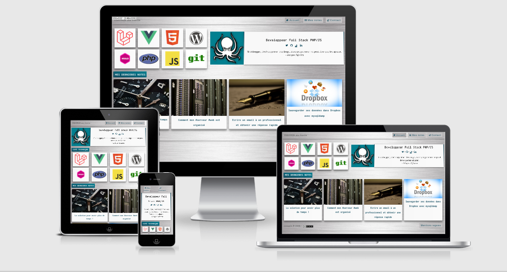

[](https://app.netlify.com/sites/suspicious-elion-891abb/deploys)



Site personnel et carnet de bord de Sonia Saugrin (**Zourite**), propulsé par [Hugo](https://gohugo.io/), [Vite](https://vite.dev/) et [Tailwind CSS v4](https://tailwindcss.com/), déployé sur [Netlify](https://www.netlify.com/).

## Développement local

Prérequis : **Node.js 22+** et **Hugo Extended 0.162.1+**.

```bash
npm install
npm start       # Lance Vite + Hugo server en parallèle
npm run build   # Build de production (Vite + Hugo --gc --minify)
```

## Auteure

- Site : [saugrin-sonia.fr](https://saugrin-sonia.fr/)
- GitHub : [@zourite](https://github.com/zourite)
- LinkedIn : [Sonia Saugrin](https://www.linkedin.com/in/ssaugrin/)
